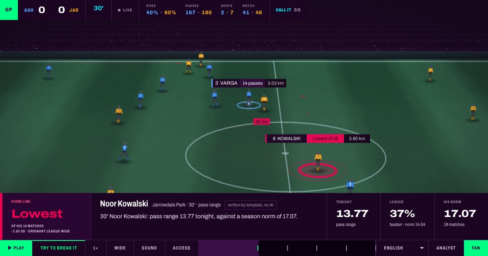

# Gegenpress

**The green sector for football.**

[](https://github.com/hectar-glitches/gegenpress/actions/workflows/ci.yml)

[](https://hectar-glitches.github.io/gegenpress/)

Built for the Microsoft × Premier League *Inside the Game* Developer Hackathon. **Category: Best Enterprise Solution.**

| | |
| --- | --- |
| **Try it** | **https://hectar-glitches.github.io/gegenpress/**. Opens in your browser. Nothing to install, no sign-in. |
| **Video** | _paste URL before submitting_ |
| **Data** | Made up, on purpose: a simulated season of 10 clubs, 90 matches and 151,435 events. No real Premier League data is used. |

---

## The gap

In Formula One, a sector turns green when a driver beats his own best, and everyone watching knows it at once. At the Olympics, every split is measured against the athlete's own season.

In football, nobody knows. Not the fan, not the commentator. Almost every number on screen compares a player with the league, not with himself.

That hides the best stories. Take Noor Kowalski. Tonight his passes average 13.77 metres. Across the league, that is normal. For him it is the shortest of his 18 matches this season. He usually plays it long; tonight he is playing it safe. A league-wide graphic calls that ordinary. Gegenpress shows it as his lowest of the season.

## Why football doesn't do this already

Two things make it hard.

**1. In a team sport, half the numbers aren't the player's.** Some stats really do describe the man: how fast he runs, how far he passes. Others mostly describe the match. "Recovery time" (how long it takes to win the ball back) depends on the opponent, the score and ten teammates far more than on whoever happened to win it. Say "he was slow to win it back tonight" and you are blaming him for the match.

**2. Writing sentences for every player, every match, means software writes them, and AI makes numbers up.** A wrong claim about a named player is unfair to him, embarrassing for the broadcaster, and, since his performance data is personal data, a legal problem too.

So broadcasters stick to safe league-wide numbers.

## What Gegenpress does about it

**It works out which numbers belong to the player.** For each stat, it measures how much players actually differ from one another, compared with how much one player varies from match to match. (Statisticians call this the ICC.) Where players barely differ, the stat says nothing about the individual, so Gegenpress refuses to make it personal. About anyone.

| Stat | How much it belongs to the player (ICC) | Personal claims |
| --- | --- | --- |
| top speed | 0.577 | allowed |
| ball speed | 0.452 | allowed |
| pass range | 0.112 | allowed |
| carry range | 0.097 | allowed |
| pass difficulty | 0.022 | refused |
| recovery time | 0.006 | refused |

The cut-off (0.08) isn't picked by eye. It is worked out from a standard measure of how reliable an average is. [`docs/SIGNAL.md`](docs/SIGNAL.md) explains the maths and the research behind it.

**It checks every number before it reaches the screen.** Whoever writes a sentence, a template or an AI, a checker compares every figure in it with the data it came from. If a number isn't there, the sentence doesn't air, and a safe template line airs instead. Across 373 test claims, not one invented number got through.

**You can try to fool it.** The console has a box called **Try to break it**. Write a sentence with a made-up number, for example *"his pass range is 21.4 tonight, the best of his season"*, and press Check. The made-up number is crossed out and you see the sentence it would say instead. The same check runs in the browser and on the server, and [a test makes sure they always agree](tests/test_browser_gate.py).

---

## For fans

**The match is live, and so are the players.** All 22 players move on the pitch. Every pass, every ball won back and every kilometre run updates the stats of the player who did it, right there on his name tag.

Getting this right took work. At first, the player the data said had the ball was the one nearest to it only 13% of the time. Now players move towards where they will next touch the ball, and the right player is nearest 90% of the time. A stat only goes up for a player the picture actually shows on the ball, so nobody is credited for someone else's pass. [Tested](tests/test_alignment.py).

**Call it.** Before each stat is revealed, you guess: *"Beaumont, ball speed tonight 16.16. Above or below his own level?"* Tap, or press ↑ or ↓. Then you see the answer and your running score. The question never gives the answer away, and [a test checks this in every language](tests/test_audio_description.py).

**Audio description.** For fans who can't see the pitch, an **Access** panel turns on spoken commentary. Choose key moments only, or full commentary: who has the ball, where it is, which side has just won it back, long passes, shots, goals with the minute and score. When you switch it on, it first tells you which team is in which colour and which way they're attacking. You can hear it through Microsoft's natural voices in Edge, the browser's own voice, or your screen reader. There are also captions, larger text and reduced motion. Every number it says comes from the data, the score or the clock, and [a test checks every line in every language](tests/test_audio_description.py).

**Five languages.** English, Spanish, French, Arabic (written right to left), and Plain English for people new to football. Every line in every language goes through the same number check.

---

## On TV

The console is built for a laptop screen. Live TV needs something different: just the graphic, laid over the match pictures, like the score box or the player name bar you already see on TV.

Add `?output=overlay` to the console's address and it becomes that graphic:

- **Only the stat bar.** The pitch, timeline and buttons disappear. Everything around the bar is see-through, so the live pictures show behind it. It is sized for a full-HD broadcast and kept clear of the screen edges, which some TVs cut off.
- **A person decides when it appears.** On live TV a producer picks the moment, not a timer. Enter puts the graphic on screen, Escape takes it off, the arrow keys choose the next one. Add `&hold=8` and it takes itself off after eight seconds.
- **Works with the software TV channels already use.** OBS, vMix and CasparCG load it as it is.
- **Made for TV.** It never asks viewers a question and never talks over the commentary. Any of the five languages, with `&lang=fr` and so on.
- **A practice view.** Add `&preview=1` to see a chequered background (so it's obvious what is see-through), the safe area, and which graphic is next. None of it goes to air.

[A test](tests/test_tv_output.py) loads it the way TV software would and checks all of the above.

<details><summary>Technical detail</summary>

Transparent 1920×1080 frame; title-safe margins of 96 px at the sides and 54 px at the bottom (5% of the picture). F8 and F9 also show and clear. CasparCG's `play`, `stop`, `next` and `update` commands control it; `update` accepts JSON such as `{"cue": 3, "lang": "fr"}`. The same lines also ship as a timed list (`overlay` in `feed.json`) for systems that draw their own graphics.

</details>

---

## Ready for a real broadcaster

A broadcaster or league putting this on air would ask: can we trust it, is it legal, and what happens when something breaks? Each answer below is backed by a test or a command, so if it ever stops being true, the build fails.

| What they need | What Gegenpress does | Proof |
| --- | --- | --- |
| **No made-up numbers** | Every figure is checked against the data before it airs. A failing sentence is swapped for a safe template line. | 100% on 373 test claims across 3 simulated seasons. The build fails below 100%. |
| **Fair to players** | Stats that describe the match, not the man, are never made personal. | [`test_form.py`](tests/test_form.py), [`test_agents.py`](tests/test_agents.py) |
| **A human in charge of AI** | A sentence written by AI stays a draft until a named producer approves it. Until then, the template line airs. Every decision goes in a log that is only ever added to. Change one character and it needs approving again. | [`test_editorial.py`](tests/test_editorial.py) |
| **AI is labelled** | A line written by AI says so on screen, with who approved it. Every line in the data also carries a hidden record of who wrote it, and a fingerprint that shows if anyone changed it later. | [`test_privacy.py`](tests/test_privacy.py), [`test_compliance.py`](tests/test_compliance.py) |
| **Players' rights over their data** | A player can get a copy of everything held about him and everything said about him on air. He can also opt out, and then he is never the subject of a personal claim. | [`test_privacy.py`](tests/test_privacy.py) |
| **Data deleted on time** | Kept for two seasons, then deleted, with a two-step delete so nothing goes by mistake. *Written, but not switched on: the free Azure tier doesn't allow it.* | [`kql/03_retention.kql`](kql/03_retention.kql) |
| **Nothing collected about viewers** | No account, no cookies, no tracking. The browser itself blocks the page from contacting any other website. | [`test_compliance.py`](tests/test_compliance.py) |
| **Only staff get in** | Data access goes through Microsoft sign-in. A sign-in setup for a hosted console is written. *Checked, but not deployed: no Azure subscription.* | [`staticwebapp.config.json`](docs/staticwebapp.config.json) |
| **Usable by disabled fans** | Audio description, captions, larger text, reduced motion, full keyboard use. An automated accessibility check finds 0 problems on six screens, and runs on every change. | [`a11y_audit.cjs`](scripts/a11y_audit.cjs) |
| **Keeps going when things break** | If the database, the AI or the writer fails, it falls back to the next option. A command breaks each one on purpose: the wording changes, the numbers never do. | [`test_resilience.py`](tests/test_resilience.py) |
| **Easy to run** | One container, checked on every change. Its health check is the number check itself. The console is a single web page. | [`Dockerfile`](Dockerfile) |
| **Other tools can use the same check** | Any AI assistant can ask Gegenpress to check a sentence before saying it (the `verify_claim` tool), so every product uses one checker instead of building its own. | [`test_mcp.py`](tests/test_mcp.py) |
| **Data stays where it's put** | The checks run inside Azure, in the region the broadcaster chooses. All languages are prepared in advance, so nothing goes to a translation service. | [`test_i18n.py`](tests/test_i18n.py) |

### The rules it follows

The EU AI Act (labelling AI-written content), GDPR (player data is personal data), the ePrivacy rules (no tracking), the European Accessibility Act and the WCAG accessibility standard. [`docs/COMPLIANCE.md`](docs/COMPLIANCE.md) goes through each one rule by rule, with the code and test behind it. There is also a [record of how player data is used](docs/privacy/ROPA.md) and a [draft privacy risk assessment](docs/privacy/DPIA.md).

### What still needs doing

Some steps need a person, a contract or money rather than code:

- A lawyer to sign off the legal decisions and the risk assessment.
- A licence for real Premier League data.
- A paid Azure subscription, to switch on sign-in, automatic deletion, Microsoft's AI voices, and instant (rather than one-to-two-minute) data updates.
- Testing sessions with blind and partially sighted fans. [The plan is written](docs/A11Y_TESTING.md).
- One deployment serves one league today.

---

## How it's built

```
simulated season ──> Azure Data Explorer ──> four agents ──> console and TV graphic
```

- **Data.** A simulated season with the same players all year, so each one has a season to be compared against. The events are loaded into **Azure Data Explorer**, Microsoft's database for large streams of events. Eleven queries there work out the match state and do the checking. The "which stats belong to the player" test runs there too.
- **Two copies of the logic, kept identical.** Everything runs in Python and in Azure's query language (KQL). A test makes sure both give exactly the same answers. Running it against the live database found two real bugs: one query had never worked, and the two copies ranked moments differently. Both are fixed, and the [test](tests/test_store.py) now holds them to the same answer, digit for digit.
- **Four agents** share one set of facts. **Scout** finds the moments worth showing. **Why** explains them. **Desk** writes the sentence, using **Microsoft Agent Framework**, or a template when no AI is set up. **Gate** checks it.
- **An MCP server** (a standard way for AI assistants to call tools) with 9 tools. `verify_claim` checks any sentence; `export_player_data` gives a player his data.
- **The console** is a single web page on GitHub Pages.

### Azure, honestly

| Service | Used for | Status |
| --- | --- | --- |
| **Azure Data Explorer** | Storing events and running the checks | **Running on a live free cluster.** Verified 24 Oct 2026. |
| Azure AI Speech | Natural voices for audio description | Written and tested against a fake server. **Not run live**: no subscription. Edge's built-in Microsoft voices are used instead. |
| Microsoft Foundry | The AI model behind Desk | Written and tested against Agent Framework 1.23.0. **Not run live**: no subscription. Templates are used instead. |

The queries also run unchanged on Microsoft Fabric.

---

## Proof

**The checker.** `python -m gegenpress eval` runs 373 claims across three simulated seasons:

| Check | Result |
| --- | --- |
| True claims let through | **100%** |
| Numbers that really come from the data | **100%** |
| Personal claims refused where they should be | **100%** |

Then the test damages the claims on purpose, to see what gets caught:

| Damage | Caught |
| --- | --- |
| A number made up | **100%** |
| A number made bigger | **99.2%** |
| A score made up | **100%** |
| A number written as a word ("twenty") | **0%**, known gap |
| A real number attached to the wrong thing | **0%**, known gap |

The checker reads digits, and it checks that a number exists in the data, not that it is attached to the right thing. So it removes made-up numbers; it doesn't make every sentence true. The two gaps are published as 0% on purpose, and [tests](tests/test_evaluate.py) make sure that stays visible.

**The simulation is realistic.** Goals, shots, passes, pass accuracy, shot quality and ball recoveries per match all land close to real top-flight averages. They also hold on three seasons the simulator was never tuned on.

**The idea holds up.** A [test](tests/test_form.py) checks, across three seasons, that there really are nights that are big for the player but ordinary for the league. If that stopped being true, the whole product would be pointless.

**The research agrees.** Real football studies find the same split: some measures differ a lot between players, others barely at all ([PLOS ONE, 2022](https://journals.plos.org/plosone/article?id=10.1371/journal.pone.0262274)). The exact numbers here are from simulated data and wouldn't carry over to real data. The method would.

178 tests in all, run on every change, along with the checker, the break-it-on-purpose run and the accessibility check.

## How it looks and sounds

The view is a TV-style camera in the stand that follows the ball, not a tactics board seen from above. That's because, showing the whole pitch, a player would be 8 pixels tall. The grass is drawn with mowing stripes and worn goalmouths. The crowd noise is real stadium recordings ([credits](docs/audio/CREDITS.md)) that get louder near the box and roar for a goal. The design notes are in [`docs/DESIGN.md`](docs/DESIGN.md).

The name: *gegenpressing* is the football tactic of winning the ball back within seconds of losing it. It's also exactly the stat Gegenpress refuses to make personal.

---

## Run it yourself

```bash
python3 -m venv .venv && source .venv/bin/activate
pip install pytest

PYTHONPATH=src python -m pytest -q              # run the tests
PYTHONPATH=src python -m gegenpress feed        # rebuild the match data
python3 scripts/serve.py                        # the console at localhost:8000
```

**Against Azure Data Explorer:**

```bash
pip install azure-kusto-data azure-kusto-ingest
export ADX_CLUSTER="https://<cluster>.kusto.windows.net"
export ADX_DATABASE="gegenpress"
PYTHONPATH=src python -m gegenpress ingest --bootstrap --reset --load
PYTHONPATH=src python -m gegenpress doctor      # checks every query works
bash scripts/verify_parity.sh                   # checks Python and Azure agree
```

**As tools for an AI assistant (MCP):**

```bash
pip install mcp
PYTHONPATH=src python -m gegenpress mcp
```

More in [`docs/MCP.md`](docs/MCP.md).

**Other commands:** `review` (approve or reject AI drafts), `export --player "<name>"` (a player's data), `verify-feed` (check nothing changed after checking), `chaos` (break things on purpose), `eval` (score the checker).

## Where things are

```
src/gegenpress/
  season.py, simulate.py   the simulated league and matches
  baselines.py, form.py    each player's season, and tonight against it
  signal.py                which stats belong to the player (ICC)
  agents.py                Scout, Why, Desk, Gate
  store.py, adx.py         the data, in Python or Azure Data Explorer
  editorial.py             producer sign-off for AI drafts
  privacy.py               player data export and opt-out
  feed.py                  everything the console and TV graphic show
  mcp_server.py            the tools for AI assistants
kql/                       the Azure Data Explorer queries
docs/                      the console, and the compliance and design notes
tests/                     178 tests
```

---

*All match data is simulated. No real Premier League data is used.*
